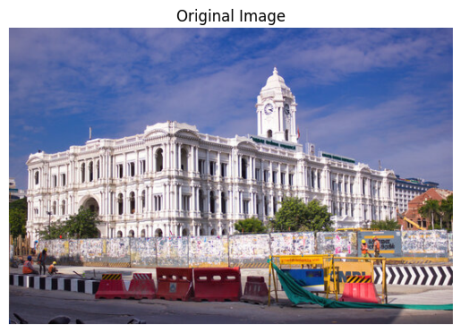
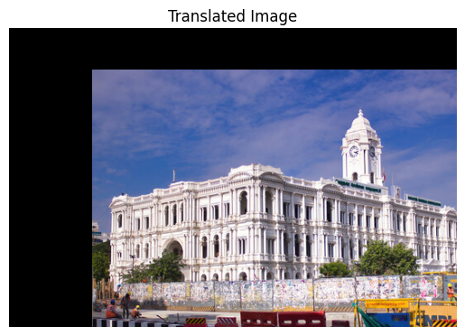
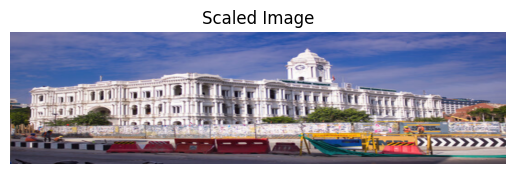
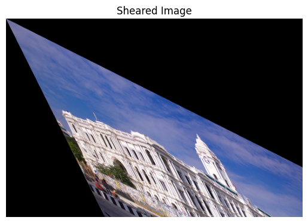
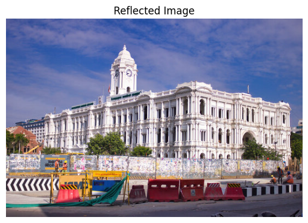
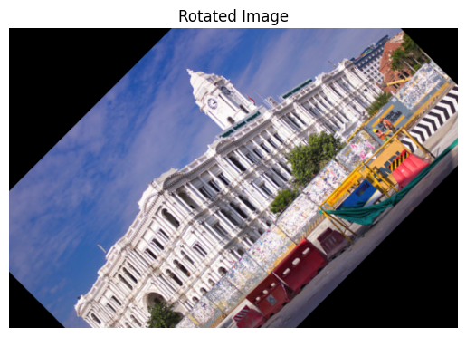
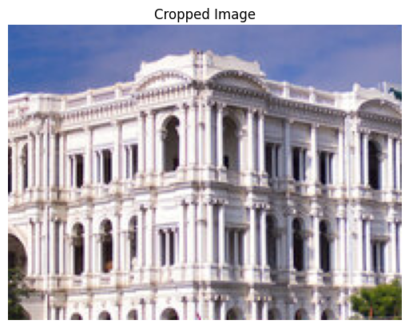

# Experiment 4: Geometric Transformations Using OpenCV

**Name:** Mithik jain G  
**Register Number:** 212224240087  

---

## Aim:
To perform image transformations such as Translation, Scaling, Shearing, Reflection, Rotation, and Cropping using OpenCV and Python.

---

## 🛠️ Software Required:
- **Anaconda** – Python 3.7+
- **OpenCV (`cv2`)**
- **NumPy**
- **Matplotlib (`matplotlib.pyplot`)**
- **Jupyter Notebook / VS Code**

---

## ⚙️ Algorithm:

- **Step 1:** Import all the necessary modules (`cv2`, `numpy`, `matplotlib.pyplot`).
- **Step 2:** Choose an image and save it as `image3.jpg` (or `filename.jpg` / `bird.png`).
- **Step 3:** Use `cv2.imread()` to read the image and convert color space using `cv2.cvtColor()` for Matplotlib display.
- **Step 4:** Define the transformation matrix and use `cv2.warpAffine()` / `cv2.warpPerspective(image, M, (cols, rows))` to translate the image.
- **Step 5:** Scale the image using `cv2.resize()` / `cv2.warpPerspective(image, M, (cols2, rows2))`.
- **Step 6:** Apply shearing, reflection, and rotation by defining the appropriate transformation matrices:
  - **Shearing:** Define a shearing matrix along the $x$-axis and $y$-axis and apply `cv2.warpAffine()`.
  - **Reflection:** Flip the image horizontally/vertically using `cv2.flip()`.
  - **Rotation:** Compute the 2D rotation matrix using `cv2.getRotationMatrix2D()` around the center point and apply `cv2.warpAffine()`.
- **Step 7:** Crop a specific region of interest (ROI) of the image using array slicing and display/save the cropped image.

---

## 💻 Program:

```python
# ==============================================================================
# Developed By: Mithik jain G
# Register No: 212224240087
# Experiment 4: Geometric Transformations Using OpenCV
# ==============================================================================
```

### 1. Import Required Libraries and Load Original Image

```python
import cv2
import numpy as np
import matplotlib.pyplot as plt

# Load the image from file
image = cv2.imread('image3.jpg')

# Display Original Image
plt.imshow(cv2.cvtColor(image, cv2.COLOR_BGR2RGB))
plt.title("Original Image")  
plt.axis('off')
plt.show()
```

---

### 2. Image Translation

```python
# Translation factors (shift by 100 pixels horizontally and 50 pixels vertically)
tx, ty = 100, 50

# Translation matrix:
# [1, 0, tx] - Horizontal shift by tx
# [0, 1, ty] - Vertical shift by ty
M_translation = np.float32([[1, 0, tx], [0, 1, ty]])

# Apply translation
translated_image = cv2.warpAffine(image, M_translation, (image.shape[1], image.shape[0]))

# Display Translated Image
plt.imshow(cv2.cvtColor(translated_image, cv2.COLOR_BGR2RGB))
plt.title("Translated Image")  
plt.axis('off')
plt.show()
```

---

### 3. Image Scaling

```python
# Scaling factors
fx, fy = 5.0, 2.0

# Resize image using linear interpolation
scaled_image = cv2.resize(image, None, fx=fx, fy=fy, interpolation=cv2.INTER_LINEAR)

# Display Scaled Image
plt.imshow(cv2.cvtColor(scaled_image, cv2.COLOR_BGR2RGB))
plt.title("Scaled Image")
plt.axis('off')
plt.show()
```

---

### 4. Image Shearing

```python
# Shearing matrix: shears the image by 0.5 in both x and y directions
shear_matrix = np.float32([[1, 0.5, 0], 
                           [0.5, 1, 0]])

# Apply shearing
sheared_image = cv2.warpAffine(image, shear_matrix, (image.shape[1], image.shape[0]))

# Display Sheared Image
plt.imshow(cv2.cvtColor(sheared_image, cv2.COLOR_BGR2RGB))
plt.title("Sheared Image")
plt.axis('off')
plt.show()
```

---

### 5. Image Reflection

```python
# Flip the image (reflection)
reflected_image = cv2.flip(image, 2)

# Display Reflected Image
plt.imshow(cv2.cvtColor(reflected_image, cv2.COLOR_BGR2RGB))
plt.title("Reflected Image")
plt.axis('off')
plt.show()
```

---

### 6. Image Rotation

```python
# Get image dimensions
(height, width) = image.shape[:2]

# Set rotation parameters: 45 degrees around center point
angle = 45
center = (width // 2, height // 2)

# Compute rotation matrix
M_rotation = cv2.getRotationMatrix2D(center, angle, 1)

# Apply rotation
rotated_image = cv2.warpAffine(image, M_rotation, (width, height))

# Display Rotated Image
plt.imshow(cv2.cvtColor(rotated_image, cv2.COLOR_BGR2RGB))
plt.title("Rotated Image")
plt.axis('off')
plt.show()
```

---

### 7. Image Cropping

```python
# Define region of interest: top-left corner (x, y) and size (w, h)
x, y, w, h = 100, 100, 200, 150

# Slicing array to crop the region
cropped_image = image[y:y+h, x:x+w]

# Display Cropped Image
plt.imshow(cv2.cvtColor(cropped_image, cv2.COLOR_BGR2RGB))
plt.title("Cropped Image")
plt.axis('off')
plt.show()
```

---

## Output:

### Original Image:


---

### i) Image Translation:


---

### ii) Image Scaling:


---

### iii) Image Shearing:


---

### iv) Image Reflection:


---

### v) Image Rotation:


---

### vi) Image Cropping:


---

## Result:
Thus, different image transformations such as Translation, Scaling, Shearing, Reflection, Rotation, and Cropping were performed using OpenCV and Python programming.
